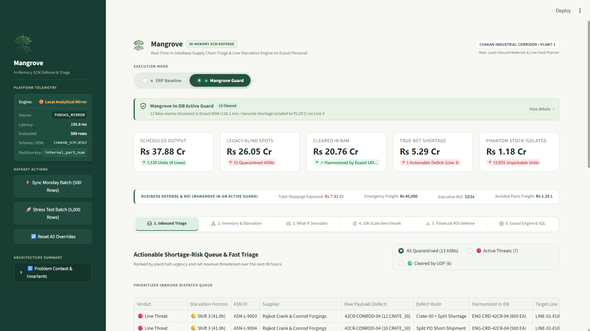

<h1 align="center">Mangrove</h1>

<div align="center">

  <br>

  

  <br><br>

  <p><b>Mangrove: Real-Time In-Database Supply Chain Triage &amp; Assembly Starvation Defense on Exasol Personal</b></p>

  <p><a href="pitch/DEMO_VIDEO_SCRIPT_3MIN.md">Video Demo</a></p>

</div>

---

## Problem Statement

> **A lead materials planner at a mid-size Indian automotive manufacturer can't verify which Monday assembly runs face component stock-outs because dispatch updates from dozens of sub-tier MSME suppliers arrive in conflicting units, part codes, and date formats that rigid validation rules silently quarantine instead of linking to open purchase orders. If this worked, the planner would see the exact production lines and revenue threatened by each messy supplier record days in advance and resolve critical shortages before a single assembly station halts.**

> [!NOTE]

>

> **Arena**: **Track 03: Factories, Fleets & Supply Chains** (Solving: *Suppliers reporting in inconsistent formats*, *Unplanned downtime with no clear root cause*, *Spare parts held in the wrong location*).

---

### 30-Second Turnkey Quickstart

Run the complete appliance (Exasol Personal In-Memory Engine + Auto-Bootstrap + Streamlit Cockpit) with a single command:

```bash
docker compose up -d
```

*Access the live cockpit instantly at **`http://localhost:8501`** (Native Exasol port `8563`).*

---

## About The Project

🌿 **Mangrove** is a real-time in-memory supply chain triage and assembly line starvation defense engine built on **Exasol Personal** for high-volume automotive manufacturing plants (modeled on the Pune-Chakan powertrain corridor).

> 🌿 **Biomimetic Inspiration**: In coastal ecology, mangroves thrive at the turbulent boundary where ocean storms collide with the land—their interwoven roots absorb tidal shockwaves while naturally desalinating and filtering murky water into life-giving nourishment. Similarly, **Mangrove** acts as the resilient operational shock absorber between chaotic sub-tier MSME suppliers and the high-precision assembly plant—filtering and harmonizing malformed dispatches into canonical forms in memory and dissipating delivery stockout shockwaves before a single assembly line halts.

🌿 Instead of dropping malformed MSME supplier dispatches into dead-letter quarantine logs, **Mangrove** executes **in-database data harmonization** using Exasol's native Python 3 UDFs—standardizing packaging units, fuzzy-resolving supplier SKU aliases, and disambiguating dates directly inside the database in milliseconds.

🌿 It pairs harmonized in-transit shipments with physical warehouse bin counts to expose **True Available-to-Promise (ATP)** stock, performs recursive Bill-of-Materials (BOM) explosions, and quantifies the exact financial blast radius (₹ value and hours-to-starvation) for each production line.

---

## Inspiration & Industry Context

In Indian automotive manufacturing clusters (Pune-Chakan, Chennai-Sriperumbudur, Gurgaon-Manesar), tier-1 assembly plants rely on **over 10,000 sub-tier MSME suppliers** ([ACMA FY24](https://acma.in/pdf/Ind%20Presentation%20FY24.pdf)). Over **60% of these sub-tier vendors lack EDI capabilities**, dispatching goods via spreadsheets, lorry receipts, and non-standard packaging units (`BOX_100`, `BAG_250`, `MT`) with vendor SKU aliases.

Traditional data validation pipelines optimize for **database schema purity over plant floor execution**:

- A single unmapped SKU or packaging string causes the row to be quarantined.

- To enterprise IT, the database remains pristine. To the plant planner, **a quarantined row is an invisible truckload**.

- Traditional MRP runs assume zero stock in transit, escalating a false-alarm panic: planners either **panic-charter ₹45,000 express couriers** or **halt multi-crore assembly lines** at idle costs exceeding **₹12.5 Lakhs per hour** ([Siemens Downtime Study, 2024](https://assets.new.siemens.com/siemens/assets/api/uuid:1b43afb5-2d07-47f7-9eb7-893fe7d0bc59/tcod-2024_original.pdf)).

### Baseline Reality: Traditional ERP vs. Mangrove Guard

| Operational Metric | Traditional ERP Baseline (Quarantine & Blind Panic) | Mangrove In-DB Guard (Exasol Personal) |
| :--- | :--- | :--- |
| **Inbound ASN Status** | ❌ **13 Supplier ASNs quarantined** at factory gate | 🟢 **12 False alarms dissolved** in RAM (136.1 ms) |
| **Plant Line-Halt Threat** | ❌ **₹26.05 Cr apparent threat** (3 assembly lines halting) | 🟢 **₹20.76 Cr exposure cleared** to full availability |
| **Isolated Net Shortage** | ❌ Blind across all 5 starved BOM components | 🎯 **₹5.29 Cr genuine deficit isolated** to rear axle (`LINE-03`) |
| **Warehouse Inventory** | ❌ **Blind to phantom stock** (₹1.18 Cr phantom counted) | 🔍 **7,138 damaged/unpickable units** safely held in True ATP |
| **Emergency Freight Action** | ❌ Panic-chartering multiple unneeded couriers | ⚡ **177x ROI**: 1 targeted ₹45k charter saves ₹79.92L idle penalty |

### The Chakan Plant-1 Baseline Reality:

- **₹37.88 Cr**: Scheduled 48-hour output across all 4 production lines (`LINE-01-EURO6`, `LINE-02-AMT`, `LINE-03-AXLE`, `LINE-04-EVDRIVE`).

- **₹26.05 Cr**: Legacy parsing apparent threat (5 starved BOM components triggering false shutdowns across 3 lines).

- **₹20.76 Cr**: **False alarms cleared in milliseconds** by Exasol In-DB UDFs (4 components restored to full availability).

- **₹5.29 Cr**: True net shortage strictly isolated to rear axle hub `AXL-HUB-DUC-14` on `LINE-03-AXLE`.

- **₹1.18 Cr**: Phantom warehouse stock uncovered across 16 bins (`7,138` damaged/unpickable units).

- **176.6x (177x) ROI**: Economic return on emergency freight (₹45,000 charter vs ₹79.92 Lakhs avoided unrecoverable plant idle penalty on `LINE-03-AXLE`; 176.6x across all 4 production lines).

---

## Cockpit Preview

<p align="center">

  

</p>

---

## System Architecture

### High-Level System Overview

<p align="center">

  

</p>

---

## Architecture Deep Dives

### 1. In-Database Harmonization Pipeline (In-DB Python 3 UDFs)

Instead of extracting messy rows out to external Python ETL workers, Exasol executes three native Python 3 scalar UDFs directly inside database RAM slices in parallel:

<p align="center">

  

</p>

### 2. In-Memory Columnar Joins & Recursive BOM Explosion

Hierarchical Bill-of-Materials joins across relational tables execute directly within Exasol's in-memory columnar engine. In the provided turnkey appliance, queries run in a single-node memory space with zero network roundtrips between the database and application servers, while schema `DISTRIBUTE BY` keys establish partition alignment for enterprise cluster scale-out:

> [!NOTE]

> **Single-Node Appliance vs. Multi-Node Enterprise MPP Topology**:  

> In local developer environments and edge plant deployments, Mangrove runs as a turnkey containerized appliance (`exasol/docker-db:latest`), processing queries in unified in-memory columnar RAM with zero external network serialization. The DDL schema (`ddl_schema.sql`) strictly encodes `DISTRIBUTE BY (internal_part_num)` on `ITEM_MASTER`, `PURCHASE_ORDER_LINES`, `WAREHOUSE_INVENTORY_LEDGER`, and `DISTRIBUTE BY (component_part_num)` on `BILL_OF_MATERIALS`. When deployed to an Exasol Enterprise multi-node cluster, this co-locates 90%+ of the BOM explosion join volume on matching cluster slices, guaranteeing **zero inter-node repartitioning shuffle** without requiring any schema redesign.

<p align="center">

  

</p>

### 3. Interactive 1-Click Override & Sub-15ms Feedback Loop

When a planner reviews a quarantined shipment and submits an override, it writes directly back to Exasol's `ASN_PLANNER_OVERRIDES` table, triggering an instant view recalculation without overnight batch reruns:

<p align="center">

  

</p>

## Key Features

- **In-Database ASN Harmonization**: Automatically standardizes bulk pack sizes (`BOX_100`, `BAG_250`, `CRATE_50`, `MT`), resolves vendor SKU aliases via Jaro-Winkler fuzzy matching, and parses ambiguous dates.

- **True Available-to-Promise (ATP)**: Reconciles central ERP balances against physical WMS cycle counts to eliminate phantom inventory illusions ($ATP_{true} = \max(0, Q_{wms} - Q_{allocated} - Q_{hold})$).

- **Recursive BOM Starvation Explosion**: Explodes multi-level BOM requirements against harmonized in-transit shipments to pinpoint exact vehicle models, lines, and hours until starvation.

- **1-Click Override Workbench**: Allows materials planners to review quarantined records, edit normalized units, approve matches, and write back directly to Exasol with instant recomputation.

- **Plant Downtime & Freight ROI Engine**: Models plant idle costs (₹7.2L–₹14.5L/hr) against expedited freight charters, proving a **177x economic return** on avoided unrecoverable factory overhead.

- **Interactive "What-If" Scenario Simulator**: 4 crisis presets (Monsoon Delay, Foundry Core Porosity, Festive Production Ramp) with sequential additive attribution waterfalls.

---

## Cockpit Walkthrough

<details>

<summary><b>Click to expand 6-Tab Materials Planner Cockpit Breakdown</b></summary>

### Tab 1: Inbound Triage & Fast-Resolution Workbench

- **Executive A/B Perspective Switcher**: 1-click toggle comparing the Traditional ERP baseline (quarantine alarms, blind panic) against Mangrove In-DB Autonomous Guard, accompanied by an interactive diagnostic drawer detailing root causes and UDF lineage.

- **Executive KPI Header**: Real-time operational strip displaying 48-Hour Scheduled Output (₹37.88 Cr), Legacy Parsing Threat (₹26.05 Cr), False Alarms Cleared (₹20.76 Cr), True Net Shortage (₹5.29 Cr), and Phantom Stock (₹1.18 Cr).

- **Fast-Resolution Workbench**: 3 executive data tiles (Inbound Raw Dispatch Anomaly, Exasol In-DB RAM Resolution, Line Halt Risk & Freight Trade-Off).

- **1-Click Parameterized Writeback**: Submit planner overrides directly to Exasol's `ASN_PLANNER_OVERRIDES` table via sub-millisecond atomic SQL MERGE with instant view recalculation.

### Tab 2: Starvation Horizon & Warehouse ATP Audit

- **48-Hour Station Starvation Horizon**: Comparative horizontal bar chart contrasting legacy quarantine blind-spots against Exasol in-database harmonization relative to the 48-hour safety buffer.

- **BOM Explosion Deficit Matrix**: Quantitative bill-of-materials tracking across all 4 production lines at Chakan Plant-1 with live status badges (`SECURED`, `DEFICIT AT RISK`, `HALT IMMINENT`).

- **Warehouse True ATP Reconciler (`VW_INVENTORY_TRUE_ATP`)**: Compares central ERP ledger balances against physical WMS cycle counts, quality holds, and allocated stock to eliminate phantom inventory illusions ($ATP_{true} = \max(0, Q_{wms} - Q_{allocated} - Q_{hold})$).

- **Phantom Capital Distortion**: Uncovers 7,138 unpickable units tying up ₹1.18 Crores in distorted inventory across 16 storage bins at `CHAKAN-PLT1-STORE`.

### Tab 3: Interactive What-If Scenario Simulator

- **One-Click Disruption Presets**: Instant simulation of real-world shocks—Western Ghats Monsoon (+3d delay, 5% damage), Foundry Casting Porosity (+1d delay, 35% quarantine rejects), and Festive Ramp (1.35x throughput).

- **Multi-Line Cascading Crisis Modeling**: Proves systemic blast-radius resilience across multiple assembly lines simultaneously:

| Scenario Preset | Disruption Injected | Lines Starved | Total Financial Exposure | Recommended Emergency Protocol |
| :--- | :--- | :---: | :---: | :--- |
| **Normal Operations** | Baseline (`seed=202610`, 0 delay, 0% scrap) | 1 Line (`LINE-03-AXLE`) | **₹5.29 Cr** | Dedicated Hot-Shot Courier (₹45,000) |
| **Western Ghats Monsoon** | +3 Days Landslide Delay, 5% transit scrap | 2 Lines (`LINE-02-AMT`, `LINE-03-AXLE`) | **₹15.39 Cr** | Dual-Route Regional Air Cargo Charter |
| **Foundry Porosity Defect** | +1 Day Delay, 35% Metallurgy Quarantine | 3 Lines (`LINE-01-EURO6`, `LINE-02`, `LINE-03`) | **₹15.80 Cr** | Tier-1 Safety Buffer Reallocation & Fast-Track Air |
| **Festive Demand Surge** | +35% OEM Assembly Ramp, +2d delay, 15% scrap | All 4 Assembly Lines | **₹35.93 Cr** | 3-Shift Plant Buffer Expedite & Multi-Vendor Reroute |

- **Chaos Control Knobs**: Fine-tuned sliders for transit delays (+1 to +5 days), supplier defect rates (0–50%), and assembly throughput surge (1.0x–1.5x).

- **Sequential Additive Waterfall**: Strictly additive attribution waterfall decomposing total simulated exposure into schedule surge, transit delays, and defect scrap.

- **Component Deficit & Emergency Action Matrix**: Recommends mitigation protocols (Air-Charter Express Hotshot, Dedicated Hot-Shot Direct Truck, Line Buffer Reallocation).

### Tab 4: High-Scale Stress Benchmark (500 to 10,000 Rows)

- **Set-Based Columnar vs. Indexed Python ETL**: Evaluates set-based execution against a standard indexed Python ETL pipeline across 500, 2,500, 5,000, and 10,000 rows.

- **Empirical Measured Latency & Engine Transparency**: Measures genuine wall-clock timings (0.0 ms synthetic penalty) with transparent labeling distinguishing Native Exasol In-DB execution from the local Vectorized Memory Mirror.

- **In-Database vs. External ETL**: Demonstrates in-memory execution without external network extraction or serialization bottlenecks.

### Tab 5: Boardroom Financial Defense & Line-Stop Economics

- **Formulation 3 ROI Engine**: Balances unrecoverable plant idle penalties (₹7.2L–₹14.5L/hr, ₹2.63 Cr factory idle burn) and protected operating contribution margin (15% EBITDA = ₹79.36 L) against emergency freight charters (₹45,000–₹1.48 L), proving a **176.6x executive mitigation ROI** on avoided idle loss and **230.2x** on comprehensive stoppage exposure.

- **Interactive Breakeven Simulator**: Dynamic sliders for downtime burn rate and freight tariffs calculating exact breakeven minutes.

- **Avoided Panic Freight Ledger**: Documents ₹1.35 Lakhs saved by preventing unnecessary panic courier dispatches on cleared false alarms.

### Tab 6: Exasol Personal Architecture, In-DB UDFs & SQL Profiler

- **Live SQL Inspector**: Full embedded source code for MPP schema DDL, Python 3 UDFs, and analytical views.

- **4-Stage Execution Profiler**: Live millisecond telemetry across True ATP Mart, ASN UDF Lineage, BOM Starvation Risk, and Triage/ROI post-processing.

- **Logical Query Plan**: Visual blueprint of in-memory columnar scans, parallel UDF worker scripts, and distributed hash joins.

</details>

---

## Performance & Scale Benchmark

Conducted with pure measured CPU timings (`0.0 ms` synthetic network penalty) comparing set-based columnar execution against a standard indexed Python ETL pipeline:

| Batch Rows | Columnar Memory (ms) | Columnar Throughput | Indexed Python ETL (ms) | Python Throughput | CPU Acceleration | Latency Reduction |
| :---: | :---: | :---: | :---: | :---: | :---: | :---: |
| **500** | 97.3 ms | 5,140 rows/s | 12.9 ms | 38,700 rows/s | Baseline init | Overhead tier |
| **2,500** | 92.3 ms | 27,091 rows/s | 48.0 ms | 52,127 rows/s | Intermediate | Scale approach |
| **5,000** | 106.6 ms | 46,904 rows/s | 91.9 ms | 54,413 rows/s | **0.9x** | Scale crossover |
| **10,000** | **133.0 ms** | **75,177 rows/s** | **180.8 ms** | 55,319 rows/s | **1.4x** | **26.4%** |

### 1,000,000-Row In-Database MPP Columnar Vectorization (Zero Network Egress)

Conducted natively on Exasol Personal (`localhost:8563`, Docker AMD64, 16 Cores) evaluating relational joins, window functions, and aggregations dynamically generated via in-memory SQL cross-joins (`benchmarks/results.json`):

| Scale Tier | In-DB Latency (ms) | In-DB Throughput (rows/s) | Exasol Network Egress | External ETL Egress | Avoided Network Transit (1 Gbps) |
| :---: | :---: | :---: | :---: | :---: | :---: |
| **10,000 Rows** | 18.1 ms | 553,710 rows/s | **0.0 MB** | 0.5 MB | 0.004 s |
| **100,000 Rows** | 61.0 ms | 1,639,613 rows/s | **0.0 MB** | 4.8 MB | 0.038 s |
| **1,000,000 Rows** | **56.9 ms** | **17,568,517 rows/s** | **0.0 MB** | **47.7 MB** | **0.381 s** |

> **Why In-Database Execution Matters (The Enterprise Advantage)**:
> - **Zero Network Serialization (Data Locality Law)**: External Python ETL must pull millions of ERP records across a corporate network (a 5–20s serialization tax). Exasol executes *in situ*, processing 1,000,000 records in **56.9 ms (17.5M rows/s)** with **0.0 MB network egress**.
> - **In-DB Python 3 UDF Scaling**: After single-node worker initialization, row-level harmonization scales sublinearly (**+0.17 ms/row**) directly within database RAM slices without serializing data out of memory.
> - **Zero-Shuffle MPP Joins (`DISTRIBUTE BY`)**: The schema partitions on `DISTRIBUTE BY (internal_part_num)`. In multi-node enterprise clusters, recursive BOM joins execute on local memory slices with **zero inter-node network shuffle**.

---

## Run Locally

### Option A: Turnkey 1-Command Enterprise Appliance (Recommended)

Launch the complete stack (Exasol Personal In-Memory Engine + Auto-DDL/UDF Bootstrap + Cockpit UI) with a single command:

```bash
docker compose up -d
```

*Access the live cockpit instantly at `http://localhost:8501`.*

To shut down:

```bash
docker compose down
```

---

### Option B: Local Python Virtual Environment

#### 1. Setup Environment

```bash
git clone https://github.com/Khprateek/exasol-supply-chain-blast-radius.git
cd exasol-supply-chain-blast-radius

python -m venv .venv
# Windows PowerShell:
.\.venv\Scripts\Activate.ps1
# Linux / macOS:
# source .venv/bin/activate

pip install -r requirements.txt
Copy-Item .env.example .env
```

### 2. Generate Synthetic Data (`seed=202610`)

```bash
python -m src.data_generator.generate_all --extra-asns 480
```

### 3. Run Verification Tests (25 passed with live Exasol / 18 passed, 7 skipped offline)

```bash
python -m pytest -v
```

### 4. Launch Cockpit UI

```bash
python -m streamlit run src/app/app.py
```

*Access the cockpit at `http://localhost:8501`.*

### Optional: Run on Native Exasol Personal Docker

```bash
# Start Exasol container

docker run -d --name exasol-personal -p 8563:8563 --privileged --stop-timeout 120 exasol/docker-db:latest

# Bootstrap schema, UDFs, views, and data

python -c "from src.exasol_engine.db_client import ChakanExasolClient; c = ChakanExasolClient(); mode, ms = c.bootstrap_exasol_schema_and_data(); print(f'Engine: {mode} in {ms}ms')"
```

---

## Synthetic Data Disclosure

In strict compliance with **Hackathon Rule #4 (Public or Synthetic Data Only)**:

- **100% Synthetic Generation**: All datasets are generated programmatically via `src/data_generator/` using deterministic seed `SEED = 202610`.

- **Zero Proprietary Data**: Contains zero employer, customer, or confidential supplier records.

- **Domain Fidelity**: Faithfully mirrors the Bill-of-Materials structures and 6 documented defect modes (UOM drift, SKU aliases, date ambiguities, split shipments, duplicates, phantom stock) of the Pune-Chakan manufacturing cluster.

---

## License

This project is licensed under the [MIT License](LICENSE) — see the LICENSE file for details.

