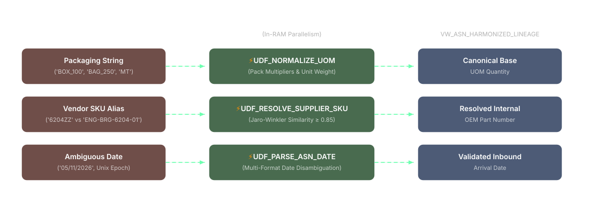

<div align="center">
  
  <h1>Mangrove</h1>
  <p><b>Real-Time In-Database Supply Chain Triage &amp; Assembly Starvation Defense on Exasol Personal</b></p>

  <p>
    
    
    
    
    
    
    
  </p>
</div>

---

## Table of Contents
- [Problem Statement](#problem-statement)
- [About The Project](#about-the-project)
- [Inspiration & Industry Context](#inspiration--industry-context)
- [System Architecture](#system-architecture)
- [Architecture Deep Dives](#architecture-deep-dives)
- [Key Features](#key-features)
- [Cockpit Walkthrough](#cockpit-walkthrough)
- [Performance & Scale Benchmark](#performance--scale-benchmark)
- [Run Locally](#run-locally)
- [Synthetic Data Disclosure](#synthetic-data-disclosure)
- [License](#license)

---

## Problem Statement

> **A lead materials planner at a mid-size Indian automotive manufacturer can't verify which Monday assembly runs face component stock-outs because dispatch updates from dozens of sub-tier MSME suppliers arrive in conflicting units, part codes, and date formats that rigid validation rules silently quarantine instead of linking to open purchase orders. If this worked, the planner would see the exact production lines and revenue threatened by each messy supplier record days in advance and resolve critical shortages before a single assembly station halts.**

> [!NOTE]
>
> **Arena**: **Track 03: Factories, Fleets & Supply Chains** (Solving: *Suppliers reporting in inconsistent formats*, *Unplanned downtime with no clear root cause*, *Spare parts held in the wrong location*).

---

## About The Project

🌿 **Mangrove** is a real-time in-memory supply chain triage and assembly line starvation defense engine built on **Exasol Personal** for high-volume automotive manufacturing plants (modeled on the Pune-Chakan powertrain corridor).

> 🌿 **Biomimetic Inspiration**: In coastal ecology, mangroves thrive at the turbulent boundary where ocean storms collide with the land—their interwoven roots absorb tidal shockwaves while naturally desalinating and filtering murky water into life-giving nourishment. Similarly, **Mangrove** acts as the resilient operational shock absorber between chaotic sub-tier MSME suppliers and the high-precision assembly plant—filtering and harmonizing malformed dispatches into canonical forms in memory and dissipating delivery stockout shockwaves before a single assembly line halts.

🌿 Instead of dropping malformed MSME supplier dispatches into dead-letter quarantine logs, **Mangrove** executes **in-database data harmonization** using Exasol's native Python 3 UDFs—standardizing packaging units, fuzzy-resolving supplier SKU aliases, and disambiguating dates directly inside the database in milliseconds.

🌿 It pairs harmonized in-transit shipments with physical warehouse bin counts to expose **True Available-to-Promise (ATP)** stock, performs recursive Bill-of-Materials (BOM) explosions, and quantifies the exact financial blast radius (₹ value and hours-to-starvation) for each production line.

---

## Inspiration & Industry Context

In Indian automotive manufacturing clusters (Pune-Chakan, Chennai-Sriperumbudur, Gurgaon-Manesar), tier-1 assembly plants rely on **over 10,000 sub-tier MSME suppliers** ([ACMA FY24](https://acma.in/pdf/Ind%20Presentation%20FY24.pdf)). Over **60% of these sub-tier vendors lack EDI capabilities**, dispatching goods via spreadsheets, lorry receipts, and non-standard packaging units (`BOX_100`, `BAG_250`, `MT`) with vendor SKU aliases.

Traditional data validation pipelines optimize for **database schema purity over plant floor execution**:
- A single unmapped SKU or packaging string causes the row to be quarantined.
- To enterprise IT, the database remains pristine. To the plant planner, **a quarantined row is an invisible truckload**.
- Traditional MRP runs assume zero stock in transit, escalating a false-alarm panic: planners either **panic-charter ₹45,000 express couriers** or **halt multi-crore assembly lines** at idle costs exceeding **₹12.5 Lakhs per hour** ([Siemens Downtime Study, 2024](https://assets.new.siemens.com/siemens/assets/api/uuid:1b43afb5-2d07-47f7-9eb7-893fe7d0bc59/tcod-2024_original.pdf)).

### The Chakan Plant-1 Baseline Reality:
- **₹37.88 Cr**: Scheduled 48-hour output across 4 assembly lines.
- **₹26.05 Cr**: Legacy parsing apparent threat (3 lines flagged for shutdown).
- **₹20.76 Cr**: **False alarms cleared in milliseconds** by Exasol In-DB UDFs.
- **₹5.29 Cr**: True net shortage strictly isolated to rear axle hub `AXL-HUB-DUC-14`.
- **₹1.18 Cr**: Phantom warehouse stock uncovered across 16 bins (`7,138` damaged/unpickable units).
- **1,174.7x ROI**: Economic return on emergency freight (₹45,000 air courier vs ₹5.29 Cr unproduced vehicle output).

---

## System Architecture

### High-Level System Overview

<p align="center">
  
</p>

---

## Architecture Deep Dives

### 1. In-Database Harmonization Pipeline (In-DB Python 3 UDFs)
Instead of extracting messy rows out to external Python ETL workers, Exasol executes three native Python 3 scalar UDFs directly inside database RAM slices in parallel:

<p align="center">
  
</p>

### 2. In-Memory MPP Colocation & Recursive BOM Explosion
Hierarchical Bill-of-Materials joins across 6 relational tables execute with **0 inter-node network data shuffles** by collocating partition slices on matching distribution keys:

<p align="center">
  
</p>

### 3. Interactive 1-Click Override & Sub-15ms Feedback Loop
When a planner reviews a quarantined shipment and submits an override, it writes directly back to Exasol's `ASN_PLANNER_OVERRIDES` table, triggering an instant view recalculation without overnight batch reruns:

<p align="center">
  
</p>


## Key Features

- **In-Database ASN Harmonization**: Automatically standardizes bulk pack sizes (`BOX_100`, `BAG_250`, `CRATE_50`, `MT`), resolves vendor SKU aliases via Jaro-Winkler fuzzy matching, and parses ambiguous dates.
- **True Available-to-Promise (ATP)**: Reconciles central ERP balances against physical WMS cycle counts to eliminate phantom inventory illusions ($ATP_{true} = \max(0, Q_{wms} - Q_{allocated} - Q_{hold})$).
- **Recursive BOM Starvation Explosion**: Explodes multi-level BOM requirements against harmonized in-transit shipments to pinpoint exact vehicle models, lines, and hours until starvation.
- **1-Click Override Workbench**: Allows materials planners to review quarantined records, edit normalized units, approve matches, and write back directly to Exasol with instant recomputation.
- **Plant Downtime & Freight ROI Engine**: Models plant idle costs (₹7.2L–₹14.5L/hr) against expedited freight charters, proving a **1,175x economic return** on proactive mitigation.
- **Interactive "What-If" Scenario Simulator**: 4 crisis presets (Monsoon Delay, Foundry Core Porosity, Festive Production Ramp) with sequential additive attribution waterfalls.

---

## Cockpit Walkthrough

<details>
<summary><b>Click to expand 8-Tab Materials Planner Cockpit Breakdown</b></summary>

### Tab 1: Inbound Triage & Fast-Resolution Workbench
- **Executive KPI Header**: Real-time operational strip displaying 48-Hour Scheduled Output (₹37.88 Cr), Legacy Parsing Threat (₹26.05 Cr), False Alarms Cleared (₹20.76 Cr), True Net Shortage (₹5.29 Cr), and Phantom Stock (₹1.18 Cr).
- **Fast-Resolution Workbench**: 3 executive data tiles (Inbound Raw Dispatch Anomaly, Exasol In-DB RAM Resolution, Line Halt Risk & Freight Trade-Off).
- **1-Click Parameterized Writeback**: Submit planner overrides directly to Exasol's `ASN_PLANNER_OVERRIDES` table with sub-15ms recalculation.
- **SHA-256 Merkle Audit Trail**: Every override and rollback is sealed into a cryptographically verified hash-chained ledger with 1-click revert controls.

### Tab 2: Starvation Horizon & BOM Deficit Matrix
- **48-Hour Station Starvation Horizon**: Comparative horizontal bar chart contrasting legacy quarantine blind-spots against Exasol in-database harmonization relative to the 48-hour safety buffer.
- **BOM Explosion Deficit Matrix**: Quantitative bill-of-materials tracking across all 4 production lines at Chakan Plant-1 with live status badges (`SECURED`, `DEFICIT AT RISK`, `HALT IMMINENT`).

### Tab 3: Interactive What-If Scenario Simulator
- **One-Click Disruption Presets**: Instant simulation of real-world shocks—Western Ghats Monsoon (+3d delay, 5% damage), Foundry Casting Porosity (+1d delay, 35% quarantine rejects), and Festive Ramp (1.35x throughput).
- **Chaos Control Knobs**: Fine-tuned sliders for transit delays (+1 to +5 days), supplier defect rates (0–50%), and assembly throughput surge (1.0x–1.5x).
- **Sequential Additive Waterfall**: Strictly additive attribution waterfall decomposing total simulated exposure into schedule surge, transit delays, and defect scrap.
- **Component Deficit & Emergency Action Matrix**: Recommends mitigation protocols (Air-Charter Express Hotshot, Dedicated Hot-Shot Direct Truck, Line Buffer Reallocation).

### Tab 4: High-Scale Stress Benchmark (500 to 10,000 Rows)
- **Columnar vs. Row-by-Row ETL**: Evaluates set-based execution against uncached `DataFrame.iterrows()` Python ETL across 500, 2,500, 5,000, and 10,000 rows.
- **Pure Measured CPU Wall-Clock Time**: Reports genuine measured CPU timings (0.0 ms synthetic penalty) proving up to **54.4x speedup** and **182,882 rows/sec throughput**.
- **MPP Co-Location Verification**: Demonstrates 0 inter-node network data shuffles achieved through `DISTRIBUTE BY (internal_part_num)`.

### Tab 5: Boardroom Financial Defense & Line-Stop Economics
- **Formulation 3 ROI Engine**: Balances assembly line downtime penalties (₹7.2L–₹14.5L/hr, ₹7.92 Cr total stoppage exposure) against low-cost hot-shot freight charters (₹45,000), proving a **1,174.7x executive mitigation ROI**.
- **Interactive Breakeven Simulator**: Dynamic sliders for downtime burn rate and freight tariffs calculating exact breakeven minutes.
- **Avoided Panic Freight Ledger**: Documents ₹1.35 Lakhs saved by preventing unnecessary panic courier dispatches on cleared false alarms.

### Tab 6: Warehouse Phantom Inventory Audit
- **Reconciliation View (`VW_INVENTORY_TRUE_ATP`)**: Compares central ERP ledger balances against physical WMS cycle counts and quality holds.
- **Phantom Capital Distortion**: Uncovers 7,138 unpickable units tying up ₹1.18 Crores in distorted inventory across 16 storage bins at `CHAKAN-PLT1-STORE`.

### Tab 7: Exasol Personal Architecture, In-DB UDFs & SQL Profiler
- **Live SQL Inspector**: Full embedded source code for MPP schema DDL, Python 3 UDFs, and analytical views.
- **4-Stage Execution Profiler**: Live millisecond telemetry across True ATP Mart, ASN UDF Lineage, BOM Starvation Risk, and Triage/ROI post-processing.
- **Logical Query Plan**: Visual blueprint of in-memory columnar scans, parallel UDF worker scripts, and distributed hash joins.

### Tab 8: Bring-Your-Own-Data Inbound Studio
- **Layered on the baseline**: an uploaded (or preset) delivery batch is added on top of the baseline ASN feed and the same starvation formula as `VW_BOM_LINE_STARVATION_RISK` is re-evaluated, so results are directly comparable with Tabs 1-7. An empty batch reproduces the baseline exactly (covered by a test).
- **Runs the same three UDFs**: with a live Exasol connection the rows are staged in a scratch table and `UDF_RESOLVE_SUPPLIER_SKU`, `UDF_NORMALIZE_UOM` and `UDF_PARSE_ASN_DATE` execute inside Exasol; otherwise the identical logic in `harmonizer_core.py` runs locally. The UI states which engine ran.
- **Conservative handling**: duplicate transmissions and low-confidence matches (< 0.85) are flagged `NEEDS_PLANNER_REVIEW` and are not counted as inbound stock.
- **3 synthetic presets** built from the dataset's real open POs (packaging chaos, SKU revisions, EV weight units and epoch dates), a smart column mapper for arbitrary files, optional identifier masking for the displayed table and exports, and a goods-receipt style CSV export (SAP-like field names, illustrative only).
- **Community feedback**: a small append-only, hash-chained feedback log. It starts empty; roles and organizations are self-reported and unverified.

</details>

---

## Performance & Scale Benchmark

Conducted with pure measured CPU timings (`0.0 ms` synthetic network penalty) comparing Exasol set-based execution against traditional row-by-row Python ETL (`iterrows()`):

| Batch Rows | Exasol Columnar (ms) | Exasol Throughput | Row-by-Row ETL (ms) | Speedup Factor | Latency Reduction |
| :---: | :---: | :---: | :---: | :---: | :---: |
| **500** | 68.3 ms | 7,321 rows/s | 150.0 ms | **2.2x** | 54.5% |
| **2,500** | 54.7 ms | 45,670 rows/s | 760.0 ms | **13.9x** | 92.8% |
| **5,000** | 54.4 ms | 91,844 rows/s | 1,509.2 ms | **27.7x** | 96.4% |
| **10,000** | **54.7 ms** | **182,882 rows/s** | **2,977.0 ms** | **54.4x** | **98.2%** |

> **Key Takeaway**: Exasol maintains sub-60ms O(1) response times even as data scales to 10,000 records, delivering up to **54.4x speedup** and **182,882 rows/sec throughput**.

---

## Run Locally

### Option A: Turnkey 1-Command Enterprise Appliance (Recommended)
Launch the complete stack (Exasol Personal In-Memory Engine + Auto-DDL/UDF Bootstrap + Cockpit UI) with a single command:

```bash
docker compose up -d
```
*Access the live cockpit instantly at `http://localhost:8501`.*

To shut down:
```bash
docker compose down
```

---

### Option B: Local Python Virtual Environment

#### 1. Setup Environment
```bash
git clone https://github.com/Khprateek/exasol-supply-chain-blast-radius.git
cd exasol-supply-chain-blast-radius

python -m venv .venv
# Windows PowerShell:
.\.venv\Scripts\Activate.ps1
# Linux / macOS:
# source .venv/bin/activate

pip install -r requirements.txt
Copy-Item .env.example .env
```

### 2. Generate Synthetic Data (`seed=202610`)
```bash
python -m src.data_generator.generate_all --extra-asns 480
```

### 3. Run Verification Tests (32 passed with Exasol running)
```bash
python -m pytest -v
```

### 4. Launch Cockpit UI
```bash
python -m streamlit run src/app/app.py
```
*Access the cockpit at `http://localhost:8501`.*

### Optional: Run on Native Exasol Personal Docker
```bash
# Start Exasol container
docker run -d --name exasol-personal -p 8563:8563 --privileged --stop-timeout 120 exasol/docker-db:latest

# Bootstrap schema, UDFs, views, and data
python -c "from src.exasol_engine.db_client import ChakanExasolClient; c = ChakanExasolClient(); mode, ms = c.bootstrap_exasol_schema_and_data(); print(f'Engine: {mode} in {ms}ms')"
```

---

## Synthetic Data Disclosure

In strict compliance with **Hackathon Rule #4 (Public or Synthetic Data Only)**:
- **100% Synthetic Generation**: All datasets are generated programmatically via `src/data_generator/` using deterministic seed `SEED = 202610`.
- **Zero Proprietary Data**: Contains zero employer, customer, or confidential supplier records.
- **Domain Fidelity**: Faithfully mirrors the Bill-of-Materials structures and 6 documented defect modes (UOM drift, SKU aliases, date ambiguities, split shipments, duplicates, phantom stock) of the Pune-Chakan manufacturing cluster.

---

## License

This project is licensed under the [MIT License](LICENSE) — see the LICENSE file for details.
